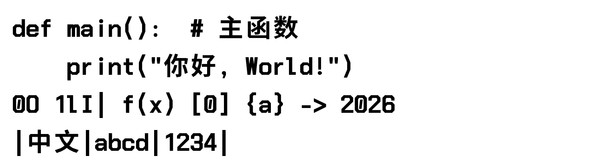
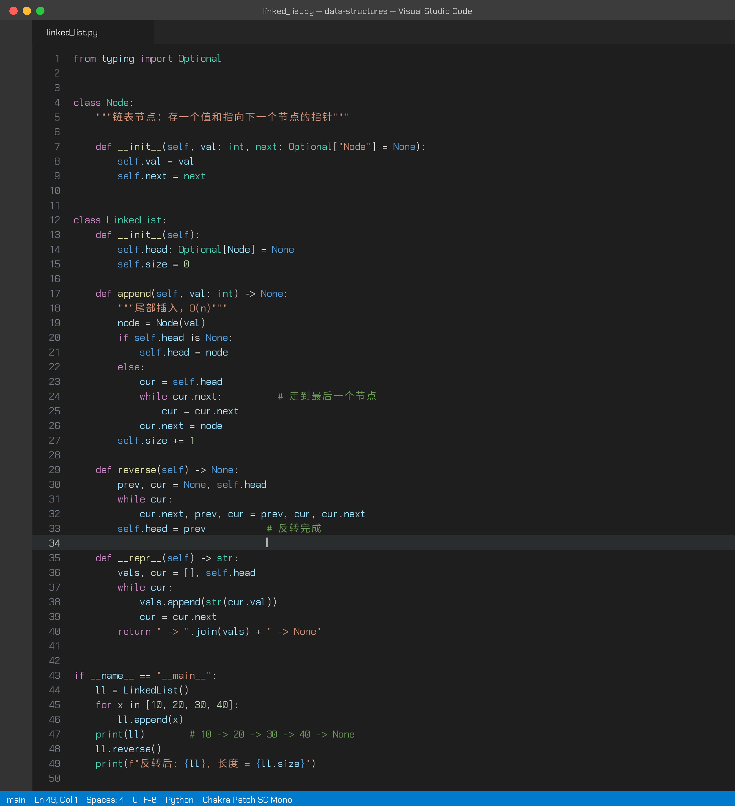

# Chakra Petch SC

为 [Chakra Petch](https://github.com/m4rc1e/Chakra-Petch) 补上中文字形的非官方衍生字体：方正骨架、曲线拉直、转角统一 45° 切角，英文和数字保留 Chakra Petch 原字。

An unofficial CJK companion to Chakra Petch: Han glyphs with straightened curves and 45° chamfered corners, Latin from Chakra Petch itself.


## 字体 / Fonts

| 家族 Family | 字重 Weights | 说明 |
|---|---|---|
| Chakra Petch SC | Regular, SemiBold, Bold | 比例字体，约 3.1 万字形（简繁汉字、假名、全角标点） |
| Chakra Petch SC Mono | Regular, SemiBold, Bold | 等宽，半角 550 / 全角 1100（2:1 对齐）；斜线 0、可区分的 I / l、折角圆括号、无连字 |

下载 [`fonts/`](fonts/) 里的 `.ttf` 双击安装。VS Code：

SemiBold 在字体列表里显示为独立家族 `Chakra Petch 中文 SemiBold` / `Chakra Petch SC SemiBold`，方便不支持字重选择的软件直接选用。

```json
"editor.fontFamily": "'Chakra Petch SC Mono'"
```





## 构建 / Build

依赖 `fonttools`。汉字骨架来自 [Noto Sans SC](https://github.com/google/fonts/tree/main/ofl/notosanssc)（思源黑体）。

```bash
fonttools varLib.instancer "NotoSansSC[wght].ttf" wght=700 -o NotoSC-Bold.ttf
python3 scripts/build_font.py NotoSC-Bold.ttf ChakraPetch-Bold.ttf ChakraPetchSC-Bold.ttf Bold
python3 scripts/fix_sc.py ChakraPetchSC-Bold.ttf
python3 scripts/mono_font.py ChakraPetchSC-Bold.ttf ChakraPetchSCMono-Bold.ttf Bold
```

`build_font.py` 里的 `OUTER_C` / `HOLE_C` / `DP_TOL` 控制切角大小和折线化程度。

## 协议 / License

SIL Open Font License 1.1，见 [OFL.txt](OFL.txt)。

- Latin glyphs: Copyright 2018 The Chakra Petch Project Authors.
- Han glyphs derived from Noto Sans SC / Source Han Sans, © 2014-2021 Adobe, with Reserved Font Name "Source".

本项目与 Chakra Petch 原作者、Google、Adobe 无关。
